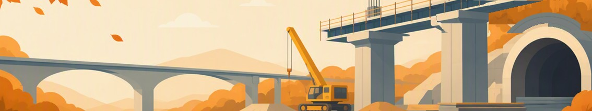

# Bandeau illustré « ruban chantier » — kit de réutilisation

Bandeau d'en-tête utilisé dans **Contrat Game** : bande bleu VINCI avec l'illustration de chantier
(pont, grue, piles, tunnel) calée à droite, fondue dans le bleu à gauche, titre + sous-titre en blanc,
bouton à droite (ex. « Profil ») et liseré rouge en bas.



Fichier image : `ruban-chantier.jpg` (1134 × 214 px, ~44 Ko, fourni à côté de ce fichier).

Rendu :

```
┌──────────────────────────────────────────────────────────────────────────────┐
│ ☰  NOM DE L'OUTIL                        ░░▒▒▓▓ [illustration chantier] [Profil]│  ← fond #004489
│    Sous-titre de l'outil                 ░░▒▒▓▓   pont · grue · tunnel        │
├──────────────────────────────────────────────────────────────────────────────┤  ← liseré #E20025 (4 px)
```

Deux variantes :

| Variante | Usage | Hauteur |
|---|---|---|
| `bandeau` | en tête de toutes les pages de l'outil (au-dessus du contenu, à droite de la barre latérale) | 96 px (112 px ≥ 640 px) |
| `hero` | grand bandeau de la page d'accueil / de connexion, avec logo et titre | 180 px (210 px ≥ 640 px) |

---

## 1. Installation

1. Copier `ruban-chantier.jpg` dans `public/` du nouveau projet.
2. Copier le composant ci-dessous dans `src/components/layout/Ruban.tsx`.
3. **Si l'outil a une page de connexion protégée par un middleware**, exclure l'image du matcher,
   sinon elle n'est pas servie avant la connexion :

```ts
// src/middleware.ts
export const config = {
  matcher: ['/((?!api/auth|_next/static|_next/image|fonts|favicon.ico|ruban-chantier.jpg).*)'],
}
```

Prérequis : Next.js (App Router) + Tailwind CSS. Le composant n'utilise **aucune** couleur de thème
personnalisée (valeurs hexadécimales VINCI en dur) : il fonctionne tel quel dans n'importe quel projet Tailwind.

## 2. Composant `Ruban.tsx`

```tsx
/* eslint-disable @next/next/no-img-element */
import type { ReactNode } from 'react'

// ── À personnaliser pour le nouvel outil ───────────────────────────────
const NOM_OUTIL = 'NOM DE L’OUTIL'
const SOUS_TITRE = 'Sous-titre de l’outil'
const IMAGE = '/ruban-chantier.jpg'
// ───────────────────────────────────────────────────────────────────────

const BLEU = 'rgba(0,68,137,' // #004489 (bleu VINCI), complété par l'opacité
const cx = (...c: (string | false | undefined)[]) => c.filter(Boolean).join(' ')

/**
 * Ruban illustré (chantier : pont, grue, piles, tunnel).
 * - « bandeau » : bande en tête des pages ; l'illustration est affichée en entier
 *   (hauteur de la bande, calée à droite) et se fond dans le bleu à gauche.
 * - « hero » : grand bandeau d'accueil / de connexion, titre en surimpression.
 */
export function Ruban({
  variante = 'bandeau',
  titre = NOM_OUTIL,
  sousTitre = SOUS_TITRE,
  complement,
  logo,
  gauche,
  droite,
  className,
}: {
  variante?: 'hero' | 'bandeau'
  titre?: string
  sousTitre?: string
  /** ligne complémentaire sous le sous-titre (variante hero) */
  complement?: ReactNode
  /** logo affiché à gauche du titre (variante hero) */
  logo?: ReactNode
  /** contenu à gauche du titre (ex. bouton menu sur tablette) */
  gauche?: ReactNode
  /** contenu en haut à droite (ex. bouton Profil) */
  droite?: ReactNode
  className?: string
}) {
  if (variante === 'bandeau') {
    return (
      <header className={cx('relative isolate h-24 shrink-0 overflow-hidden bg-[#004489] sm:h-28', className)}>
        {/* Illustration entière, hauteur de la bande, calée à droite */}
        <div className="absolute inset-y-0 right-0 -z-10 h-full">
          
          {/* Fondu de l'illustration dans le bleu, côté gauche */}
          <div
            aria-hidden
            className="absolute inset-y-0 left-0 w-1/2"
            style={{ background: `linear-gradient(90deg, ${BLEU}1) 0%, ${BLEU}0.75) 35%, ${BLEU}0) 100%)` }}
          />
        </div>
        <div className="flex h-full items-center gap-2 px-3 sm:px-6">
          {gauche}
          <span className="text-white">
            <span className="block text-base font-bold uppercase tracking-wide sm:text-lg">{titre}</span>
            <span className="block text-xs text-white/85 sm:text-sm">{sousTitre}</span>
          </span>
        </div>
        {droite && <div className="absolute right-3 top-3 sm:right-4">{droite}</div>}
        {/* Liseré rouge VINCI */}
        <div aria-hidden className="absolute inset-x-0 bottom-0 h-1 bg-[#E20025]" />
      </header>
    )
  }

  return (
    <div className={cx('relative isolate min-h-[180px] overflow-hidden rounded-xl bg-[#004489] shadow-sm sm:min-h-[210px]', className)}>
      
      <div
        aria-hidden
        className="absolute inset-0 -z-10"
        style={{ background: `linear-gradient(90deg, ${BLEU}0.96) 0%, ${BLEU}0.88) 34%, ${BLEU}0.35) 52%, ${BLEU}0) 66%)` }}
      />
      <div className="flex h-full min-h-[inherit] items-center gap-4 px-5 py-5 sm:gap-6 sm:px-8">
        {logo}
        <div className="max-w-xl text-white">
          {titre && <h1 className="text-2xl font-bold leading-tight sm:text-3xl">{titre}</h1>}
          {sousTitre && <p className="mt-1 text-sm text-white/90 sm:text-base">{sousTitre}</p>}
          {complement && <div className="mt-2 text-sm text-white/80">{complement}</div>}
        </div>
      </div>
      <div aria-hidden className="absolute inset-x-0 bottom-0 h-1 bg-[#E20025]" />
    </div>
  )
}
```

## 3. Intégration dans la coquille de l'application

Le bandeau se place **en haut de la colonne de contenu**, à droite de la barre latérale ; seul le
contenu défile, le bandeau reste visible.

```tsx
// src/components/layout/AppShell.tsx (extrait)
'use client'
import { useState } from 'react'
import Link from 'next/link'
import { Menu, UserRound } from 'lucide-react'
import { Ruban } from './Ruban'
import { Sidebar } from './Sidebar'

export function AppShell({ children }: { children: React.ReactNode }) {
  const [menuOuvert, setMenuOuvert] = useState(false)
  return (
    <div className="flex h-screen overflow-hidden">
      <Sidebar open={menuOuvert} onClose={() => setMenuOuvert(false)} />
      <div className="flex min-w-0 flex-1 flex-col">
        <Ruban
          variante="bandeau"
          gauche={
            <button
              type="button"
              onClick={() => setMenuOuvert(true)}
              aria-label="Ouvrir le menu"
              className="rounded p-2 text-white hover:bg-[#003370] lg:hidden"
            >
              <Menu className="h-5 w-5" />
            </button>
          }
          droite={
            <Link
              href="/profil"
              className="inline-flex items-center gap-1.5 rounded-md border border-[#004489] bg-white px-3 py-1.5 text-sm font-semibold text-[#004489] shadow-sm hover:bg-[#E5EFF8]"
            >
              <UserRound className="h-4 w-4" /> Profil
            </Link>
          }
        />
        <main className="flex-1 overflow-y-auto">{children}</main>
      </div>
    </div>
  )
}
```

Page de connexion / d'accueil (variante hero) :

```tsx
<Ruban
  variante="hero"
  titre="Nom de l’outil"
  sousTitre="Sous-titre de l’outil"
  logo={}
/>
```

## 4. Charte et réglages

| Élément | Valeur |
|---|---|
| Fond | Bleu VINCI `#004489` |
| Liseré bas | Rouge VINCI `#E20025`, 4 px (`h-1`) |
| Titre | blanc, gras, majuscules, 16 px → 18 px (≥ 640 px), police VINCI Sans (fallback Arial) |
| Sous-titre | blanc 85 %, 12 px → 14 px |
| Bouton Profil | bouton secondaire VINCI : fond blanc, bordure + texte `#004489`, survol `#E5EFF8` |
| Fondu `bandeau` | sur la moitié gauche de l'image : bleu 100 % → 75 % (35 %) → 0 % |
| Fondu `hero` | bleu 96 % → 88 % (34 %) → 35 % (52 %) → 0 % (66 %) |
| Cadrage `hero` | `object-cover` centré à 85 % horizontalement (garde pont + grue visibles) |

Notes :

- L'image n'est **jamais floutée ni étirée** : en variante `bandeau` elle est affichée à la hauteur
  de la bande avec sa largeur naturelle (`w-auto max-w-none`) et dépasse à gauche sous le fondu.
- Sur écran étroit (téléphone), l'illustration est partiellement masquée par le titre : c'est voulu,
  le fondu garde le texte lisible.
- Pour une autre couleur de fond, changer `bg-[#004489]` **et** la constante `BLEU` (même teinte,
  au format `rgba(r,g,b,`), sinon le fondu laisse une bande de couleur différente.
- `isolate` + `-z-10` gardent l'image derrière le texte sans affecter le reste de la page.
